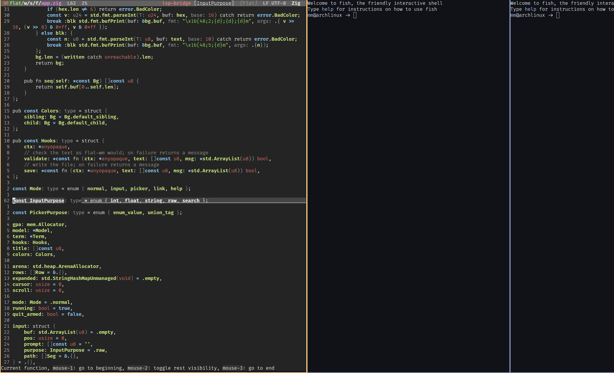
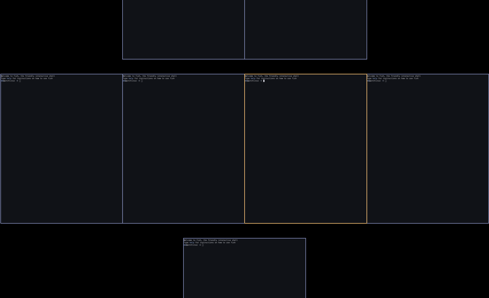
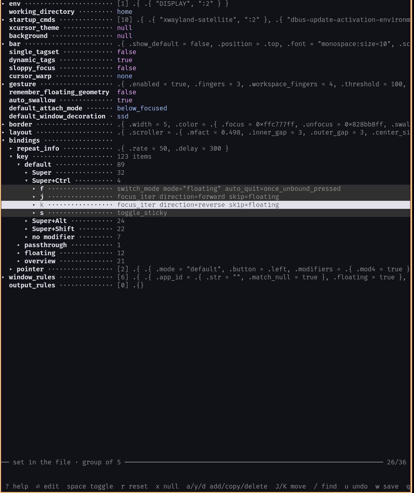

# Flat

[English](README.md) | 中文

Flat 是一个横向滚动的 Wayland 桌面，由两个程序组成：

- [`compositor/`](compositor)：合成器 `flat`，由
  [river](https://codeberg.org/river/river) 0.5.0 分支而来。
- [`wm/`](wm)：窗口管理器 `flat-wm`，由
  [kwm](https://github.com/kewuaa/kwm) 分支而来；另有 `flat-config`，TUI的配置管理器。

合成器负责绘制和输入，窗口管理器决定窗口放在哪里。两者通过 river 的 Wayland 协议通信。



## 功能

- **滚动布局。** 每一行是一条横向排开的列，左右滚动。屏幕上只有一个窗口时，可以让它居中（`center_single`）。
- **工作区。** 每个输出最多 9 个，每个工作区是若干行组成的一个平面。支持 `ext-workspace-v1` 的状态栏（如 DankMaterialShell）能列出并切换它们。
- **概览。** 把整个工作区缩小，看到所有窗口。
- **触摸板手势。** 三指在列和行之间移动，四指切换工作区。
- **动画。** 切换焦点、交换窗口、改宽度、切换行和工作区、打开和关闭窗口，都有动画。
- **窗口规则、模式**（每个模式有自己的快捷键）、吞噬终端、状态栏。
- **`flat-config`**：一个终端界面，原地修改配置，保存后让正在运行的窗口管理器重载。

在 river 的协议之外，Flat 加了两个协议。`river-window-scale-v1` 能把窗口缩放后绘制（用于概览），还能留住已关闭窗口的最后一帧（用于关闭动画）。`river-workspace-v1` 让窗口管理器发布自己的工作区，合成器再通过 `ext-workspace-v1` 转给其他程序。



## 依赖

- **zig 0.16。
- wayland、wayland-protocols、wlroots 0.20、xkbcommon 1.12 或更新、libevdev、libinput、udev、pixman、fcft、pkg-config。
- scdoc，可选，用来生成 man 手册。
- 运行时：一个终端（默认快捷键用 `foot`）、一个启动器（`wmenu-run`）；要跑 X11 程序，还需要 Xwayland 或 `xwayland-satellite`。

触摸板手势直接[27u读取 libinput，当前用户要在 `input` 组里。

## 编译和安装

```
./reinstall.sh
```

这会编译两个程序，把 `flat`、`flat-wm`、`flat-config` 装到 `~/.local`。

- `ZIG=/path/to/zig-0.16/zig ./reinstall.sh`：用指定的版本的zig，防止`$PATH`中的版本不兼容 。
- `PREFIX=/usr/local ./reinstall.sh`：装到别处。
- `--if-changed`：上次安装后源码没有变化时，什么也不做。
- 编译日志在 `~/.local/state/flat/reinstall.log`。

正在运行的会话继续用旧的程序，重新登录后才换成新的。所以在 Flat 里面重装是安全的。

手动编译：

```
cd compositor && zig build -Doptimize=ReleaseSafe -Dxwayland=true --prefix ~/.local install
cd wm && zig build -Doptimize=ReleaseSafe --prefix ~/.local install
```

各程序的编译选项见 [`compositor/README.md`](compositor/README.md) 和 [`wm/README.md`](wm/README.md)。

## 启动

在 TTY 里：

```
flat -c flat-wm
```

用登录管理器：安装时会把 `flat.desktop` 放进 `~/.local/share/wayland-sessions/`。多数登录管理器只读 `/usr/share/wayland-sessions/`，需要复制过去：

```
sudo cp ~/.local/share/wayland-sessions/flat.desktop /usr/share/wayland-sessions/
```

## 配置

flat-wm 读取 `~/.config/flat-wm/config.zon`（或 `$XDG_CONFIG_HOME/flat-wm/config.zon`）。文件是纯 [ZON](https://ziglang.org/documentation/master/#ZON)。只写要改的值，其余的用默认值。[`wm/config.def.zon`](wm/config.def.zon) 列出了全部选项，带注释。

### flat-config

```
flat-config
```

它把配置显示成一棵树。粗体的名字写在你的文件里，灰色的用默认值。配置文件不存在时，它会照默认配置建一个。



| 按键 | 作用 |
| :--- | :--- |
| `j` `k` `↑` `↓` | 移动 |
| `l` `→` / `h` `←` | 展开 / 收起分组，回到上一级 |
| `Enter` `e` | 编辑：输入值、从列表里选，或切换开关 |
| `Space` | 切换开关，展开或收起分组 |
| `E` | 按原始 ZON 文本编辑 |
| `x` | 设为 null，或给 null 一个值 |
| `r` | 重置：从文件里删掉这个值，改用默认值 |
| `a` / `y` / `d` | 新增 / 复制 / 删除列表项 |
| `J` `K` | 移动列表项 |
| `/` `n` `N` | 搜索、下一个、上一个 |
| `u` `Ctrl-r` | 撤销、重做 |
| `w` `Ctrl-s` | 保存 |
| `q` | 退出 |
| `?` | 全部按键 |

- 只改动的那个值会被重写，注释和排版都不动。
- 展开一个分组时，同一父级下、同一层里已展开的其他分组会收起。
- 键盘和鼠标的快捷键先按模式分组，再按修饰键（Super、Alt……）分组。在分组上按 `a`，新建的快捷键自动带上这一组的模式和修饰键。
- 改一个数字或字符串时，它会列出文件里其他取同一个值的地方，问你要不要一起改。这样同一个宽度、同一个间距可以一起调。
- 保存前先用 flat-wm 自己的解析器检查，flat-wm 不认的文件不会写入。第一次保存时，原文件留作 `config.zon.bak`。
- 保存后，flat-config 通知正在运行的 flat-wm 重载配置。
- 光标所在的那一层加底色，光标下面的子项也加底色。顶层不加。颜色用 `-sibling-bg COLOR` 和 `-child-bg COLOR` 设，也可以用环境变量 `$FLAT_CONFIG_SIBLING_BG` 和 `$FLAT_CONFIG_CHILD_BG`。COLOR 是 256 色序号（默认 236 和 234）、`#rrggbb` 或 `none`。

### 手动重载

按 `Mod4-Shift-r`，或者发送 `SIGUSR1`：

```
pkill -USR1 -x flat-wm
```

## 默认快捷键

`Mod4` 是 Super 键（Windows 键）。

| 按键 | 作用 |
| :--- | :--- |
| `Mod4-Shift-Return` | 打开终端（`foot`） |
| `Mod4-p` | 打开启动器（`wmenu-run`） |
| `Mod4-Shift-c` | 关闭窗口 |
| `Mod4-j` `Mod4-k` | 聚焦下一个 / 上一个窗口 |
| `Mod4-Shift-j` `Mod4-Shift-k` | 与下一个 / 上一个窗口交换 |
| `Mod4-h` `Mod4-l` | 窗口变窄 / 变宽 |
| `Mod4-Return` | 把窗口滚到中间 |
| `Mod4-c` | 窗口居中；浮动窗口移到屏幕正中 |
| `Mod4-f` | 切换浮动 |
| `Mod4-Shift-f` | 切换全屏 |
| `Mod4-1` … `Mod4-9` | 切换到工作区 |
| `Mod4-Shift-1` … `Mod4-Shift-9` | 把窗口送到工作区 |
| `Mod4-Shift-r` | 重载配置 |
| `Mod4-Shift-q` | 退出 |

完整列表见 [`wm/doc/keybindings.md`](wm/doc/keybindings.md) 和 `man flat-wm`。概览没有默认快捷键，要用时绑定 `toggle_overview` 动作。

## 目录

```
compositor/      flat，合成器（river 分支）
wm/              flat-wm 和 flat-config（kwm 分支）
  config.def.zon   全部选项，带注释
  src/flat_config/ 配置界面
reinstall.sh     编译并安装两个程序
NOTICE.md        来源、版权所有者和改动记录
```

## 许可证

Flat 是自由软件，使用 GNU 通用公共许可证第 3 版，见 [LICENSE](LICENSE)。大部分代码出自 river 和 kwm 的作者。[NOTICE.md](NOTICE.md) 记录了来源、版权所有者和改动。

Flat 不是 river，也不是 kwm。Flat 的问题请不要报给这两个项目。
